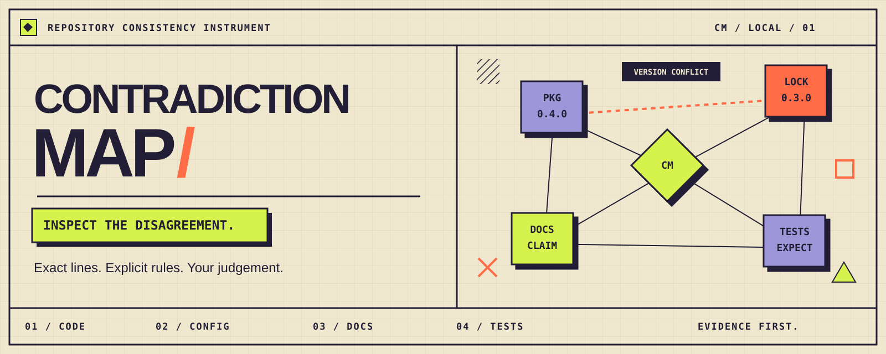
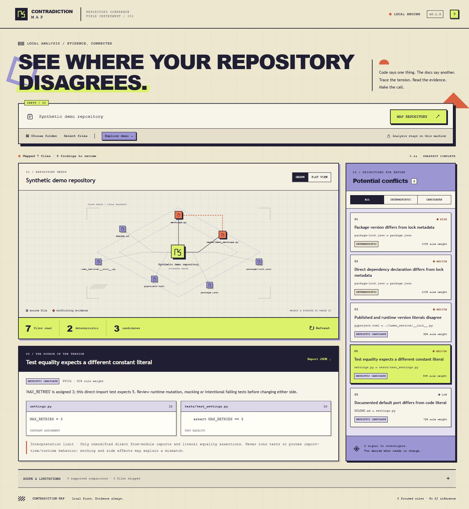

<p align="center"></p>

<p align="center"><strong>A local evidence graph for the places your repository disagrees.</strong><br>One small, inspectable engine. A visual workspace for people. Structured JSON for agents.</p>

<p align="center"><a href="#start-in-one-command">Start</a> · <a href="#what-it-actually-detects">Rules</a> · <a href="#for-agents-and-automation">Agents</a> · <a href="docs/SAFETY.md">Privacy & safety</a> · <a href="docs/COVERAGE.md">Verification & limits</a> · <a href="LICENSE">MIT license</a></p>

Contradiction Map compares explicit statements across package metadata, Python source, documentation and tests, then puts the conflicting lines next to each other. It distinguishes **deterministic metadata conflicts** from **heuristic candidates** that need a person to interpret. Every finding carries its rule, severity, confidence weight, exact evidence and limitations.

There is no model behind the demo. The same local rules power the UI, Python API and CLI. The included demo is a synthetic repository with deliberately inconsistent declarations and a separate clean counterpart.

## Start in one command

Requires **Python 3.11+**. The running application has **zero third-party Python or JavaScript dependencies**. No API key, package installation, build, account creation or paid service is needed.

```powershell
git clone https://github.com/jacksonjp0311-gif/contradiction-map.git
cd contradiction-map
.\Start-ContradictionMap.cmd
```

The Windows launcher opens `http://127.0.0.1:8765`. You can also double-click **Start-ContradictionMap.cmd** in File Explorer. Keep its terminal open; press **Ctrl+C** to stop. Opening it again reuses a verified running Contradiction Map instance. If another application owns that port, choose a different port: `.\Start-ContradictionMap.cmd serve --port 8768 --open`.

The PowerShell entry script remains available as `.\Start-ContradictionMap.ps1` when your existing script policy allows it. The command launcher and `python -m contradiction_map serve --open` require no PowerShell policy changes.

On macOS/Linux, use `python3 -m contradiction_map serve --open` from the cloned folder. Windows is the locally verified platform for this initial release. Run from the source checkout; building/distributing wheels is outside the verified workflow.

## A workspace built around evidence

1. **Choose a target.** Use the browser's real folder picker, select text files, paste a local path read by the companion service, or paste a public `https://github.com/owner/repository` URL. Try **Explore demo** first.
2. **Follow a conflict.** The right panel ranks findings. Select one to highlight its connected files in the animated nexus and compare exact source excerpts below.
3. **Read the scope.** Expand the coverage panel. Excluded files, invalid documents and limits matter when interpreting a result.
4. **Refresh deliberately.** Refresh reruns the current selection. For browser-selected files, Refresh reopens the picker so you can reselect current disk contents. Cancel stops an in-progress job; a cancelled or failed run does not produce a new result. Export JSON saves the current completed report.

The **Flat view** presents findings as readable buttons in document order. All primary actions are keyboard accessible, status updates use a live region, and reduced-motion preferences disable ornamental animation. Choose folder uses a standard browser directory picker. Typed local paths are read by the local companion when a browser cannot select a directory. No native desktop dialog dependency is required.

<p></p>

## Your first test run

1. Click **Explore demo**. Expect **5 findings: 2 deterministic conflicts and 3 heuristic candidates** across 7 text files.
2. Select **Test equality expects a different constant literal**. The source evidence should show `MAX_RETRIES = 3`; the test expects `5`. The graph highlights those two files.
3. Switch to **Flat view**, try the **Candidates** filter, and export the JSON report.
4. Paste the full local path to the checkout's `fixtures/clean` folder, or choose that folder. Expect **0 findings**. This verifies the clean example, not the consistency of arbitrary repositories.
5. Use **Refresh** after an edit to a local-path target. Browser-picked files require reselection, which Refresh opens for you. Public URL mode accepts a canonical root URL such as this project's GitHub URL; scanning this whole project also finds its intentionally inconsistent demo copies.

## What it actually detects

| Rule | Compares | Result |
| --- | --- | --- |
| `NPM001` | `package.json` version and matching package-lock root version | Deterministic metadata conflict |
| `NPM002` | Common explicit dependency/devDependency declarations and package-lock v2/v3 root metadata | Deterministic metadata conflict |
| `PY001` | Static Python `[project].version` and a matching package's literal `__version__` | Heuristic candidate |
| `PY002` | A directly imported Python constant and a literal equality assertion in a test | Heuristic candidate |
| `DOC001` | Explicit README default-port prose and a single recognized Python port default | Heuristic candidate |

Read the [rule catalog](docs/RULES.md) for exact matching conditions and abstentions. Confidence numbers are manually assigned rule weights, **not measured probabilities**. Ranking uses severity, deterministic/heuristic kind, confidence and stable tie breakers. A finding identifies conflicting declarations within these narrow patterns; it does not establish which side should change.

**A clean scan is not proof of consistency.** This release does not understand arbitrary natural-language claims, JavaScript behavior, function contracts, every configuration format, cross-service intent, security properties, dynamic versions or runtime overrides. The graph shows evidence relationships from supported findings, not a complete call or dependency graph. It displays a bounded representative set of files; JSON retains all collected file metadata and findings within stated limits.

## For agents and automation

```powershell
# Human-readable findings, no modifications to the target
.\Start-ContradictionMap.cmd scan .\fixtures\demo

# JSON on stdout, or write to an explicit local file
python -m contradiction_map scan .\fixtures\demo --json
python -m contradiction_map scan C:\path\to\repo --json --output report.json

# Opt-in failure threshold for an agent or local gate
python -m contradiction_map scan .\fixtures\demo --json --fail-on deterministic
```

Exit codes: `0` completed (including findings unless a failure threshold was selected), `1` selected finding threshold met, `2` input/operation error, `130` interrupted. JSON schema `1.0` includes `target`, `summary`, `findings`, collected `files` and `coverage`. Warnings and `coverage.truncated` must travel with findings. See [the JSON contract](docs/JSON.md).

```python
from contradiction_map.engine import scan, scan_files

report = scan("path/to/authorized/repository")
report = scan_files({"config.py": "PORT = 8080\n",
                     "README.md": "The default port is 3000.\n"})
```

A reusable [Codex skill](skills/contradiction-map/SKILL.md) explains how to interpret evidence safely. To install it, copy that `contradiction-map` skill folder to your agent's skills directory. Skill installation is optional; no global agent configuration is modified by this project. The checkout must remain available for its engine commands. The skill does not authorize fixes or publication of scanned content.

## Architecture

```text
Local folder / selected text / public GitHub snapshot
                         |
                 bounded safe collector
                         |
          parse literals -> five comparison rules
                         |
                 schema 1.0 evidence report
                    /              \
             CLI / Python API    localhost companion
                                       |
                                graph + flat UI
```

`engine.py` reads text and parses JSON, TOML and Python ASTs without importing target modules. `server.py` provides a loopback-only, token-protected local API and asynchronous cancellable jobs. `web/` is plain HTML, CSS and JavaScript with no remote assets. There are no automatically triggered GitHub workflows.

## Privacy and boundaries

Local folder/file analysis sends no repository content off the machine. Public URL mode contacts **GitHub's API and codeload host only**, without credentials, to download a bounded default-branch archive. No model endpoints, telemetry or paid API calls are configured. The server never executes repository code, tests, installers or hooks.

The collector excludes `.git`, common vendor/build/generated folders, binary/non-UTF-8 material, common secret filenames and linked/reparse inputs. It caps each file at 512 KiB, a scan at 500 text files / 8 MiB, traversal at 20,000 entries, and output at 500 findings. Reports disclose skips and partial scans. These filters are **not a secret-scanning guarantee**: eligible source may still contain sensitive text. Review a report before sharing it. Use only repositories you are authorized to inspect. [Full safety model →](docs/SAFETY.md)

## Develop and verify

```powershell
python -m unittest discover -s tests -v
node --test tests/ui-state.test.cjs
python -m compileall -q contradiction_map tests
node --check contradiction_map/web/app.js
```

Node is needed only for the optional UI developer checks, not to run the app. Tests use only synthetic fixtures and temporary folders. They exercise expected conflicts, clean/false-positive cases, path and file limits, cancellation, HTTP authorization and public-import boundaries. [Verification notes](docs/COVERAGE.md) separate tested behavior from untested behavior. There is no CI workflow, hosted runner usage or benchmark accuracy claim.

To extend a rule, add a discriminating parser-level comparison with exact evidence, a positive fixture and an intentional/clean counterexample. Keep candidate findings distinct from deterministic invariants. [MIT licensed](LICENSE).
